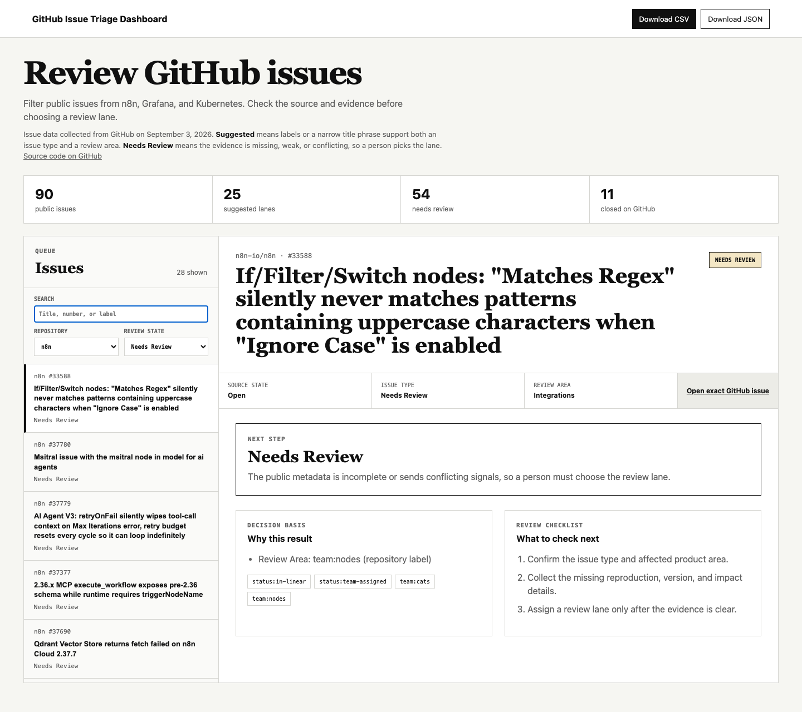

# GitHub Issue Triage Dashboard

This dashboard turns public GitHub issues from n8n, Grafana, and Kubernetes into a review queue. It helps a person who triages issues see the exact source, the evidence behind each suggested review lane, and which issues still need a human decision.

**Live site:** [duckky153.github.io/issue-triage](https://duckky153.github.io/issue-triage/)



## Key facts

From the issue data collected on September 3, 2026:

- 90 public issues, 30 from each repository.
- 25 issues have a suggested review lane, 54 are held for review, and 11 were already closed on GitHub.
- None of the 30 n8n issues gets a suggested lane. Recent n8n issues carry team and status labels but no bug or feature label, so the rules hold them for review instead of guessing.
- Every deploy first runs 23 unit tests, 15 artifact checks, and 19 browser checks. A failed check stops the release.

Built with AI assistance (Claude Code and Codex).

This is an independent project on public data. It is not affiliated with n8n, Grafana, or Kubernetes, and it has no real users. A suggested review lane comes from fixed rules and is a prompt for human review, not an assignment, priority, or maintainer decision.

## Run it

Needs Node.js 20 or newer. `npm run verify` drives a real browser, so install
Playwright's Chromium once first.

```bash
npm ci
npx playwright install chromium
npm run verify
npm run serve
```

Open `http://127.0.0.1:4191`.

If another local project is already using port 4191, choose an open port without
stopping that project:

```bash
PORT=4192 npm run serve
```

To collect new issue data and promote it only after every check passes:

```bash
npm run refresh-and-verify
```

## Build the static site

```bash
npm run build-static
npm run verify-static
npm run serve-static
```

The `dist` folder is a self-contained static site. It includes the dashboard data and both downloadable handoffs, uses relative paths so it works under a GitHub Pages project URL, and makes no API request when a visitor opens it.

The source is at `https://github.com/Duckky153/issue-triage`. The checked-in Pages workflow runs the full check suite, builds `dist`, and deploys that folder. See `docs/DEPLOYMENT.md`. Building the folder locally does not publish it.

## What the workflow does

1. Paginates the public GitHub repository-issues endpoint.
2. Removes pull requests, duplicate records, and fields that are not needed.
3. Checks the candidate record count, schema, URLs, timestamps, and SHA-256 hash.
4. Uses repository labels before narrow title phrases.
5. Marks conflicts, missing type evidence, missing review-area evidence, and needs-information labels as `Needs Review`.
6. Runs the fixed real-issue benchmark, artifact checks, browser checks, tests, syntax checks, and dependency audit.
7. Promotes the candidate as one release or restores the previous release.

The CSV and JSON handoff files contain the source URL, evidence, suggested review lane, and next-step checklist for every issue.

## Limits

The project does not show affiliation, employment, maintainer access, private support work, production use, adoption, time saved, or a business outcome. The counts above describe the September 3, 2026 data; `evidence/current-verification.json` holds the current generated result.

See `docs/USER-GUIDE.md` for how to use the dashboard and `docs/WALKTHROUGH.md` for how it works.
